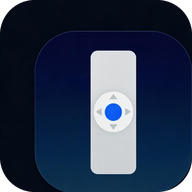

<div align="center">



# TV Remote

**Turn your phone into a remote for an Android TV box**<br>
No root · No developer options · No wireless debugging

<p>
  <a href="./README.md">简体中文</a> |
  <strong>English</strong>
</p>

<p>
  <a href="https://github.com/mst8222/tv-remote/releases/latest">
    
  </a><!--
  --><a href="https://gitee.com/moston/tv-remote/releases">
    
  </a><!--
  --><a href="./LICENSE">
    
  </a><!--
  -->
  
</p>

<p>
  <a href="#overview">Overview</a> •
  <a href="#features">Features</a> •
  <a href="#screenshots">Screenshots</a> •
  <a href="#quick-start">Quick Start</a> •
  <a href="#troubleshooting">Troubleshooting</a>
</p>

</div>

## Overview

Install a small always-on service on the box, keep both devices on the same LAN, and the phone can
control it. The service comes back automatically after a reboot. If the box app is not installed,
the phone can still work as a Bluetooth HID remote.

> [!NOTE]
> The direct protocol is **plaintext TCP** over the LAN. It is meant for a trusted home or office
> network only — never expose port 8899 to the Internet.

| | |
|---|---|
| Controller | Android phone (developed and tested on Samsung Note20 / Android 13) |
| Target | Android TV box (tested on H96 Max V56 / Android 12 and Samsung Fold3 / Android 13) |
| Prerequisites | Phone and box on the same LAN; accessibility enabled on the box (no root) |
| Build | Manual toolchain, no third-party dependencies, about 100–130 KB per APK |

It solves three everyday problems:

1. **The remote is always missing** — D-pad, OK, Back, Home, volume, mute and power are all on the phone.
2. **Typing on a TV is painful** — type a search term or account password on the phone and send it
   straight into the box's focused input field.
3. **Apps are buried in menus** — every launchable third-party app on the box (OK影视, 飞牛TV,
   Dangbei Desktop, Kodi, ...) plus system Settings is one tap away.

It also manages several boxes: scan or add devices manually, and each device remembers its own
pairing and connection mode.

## Features

| Feature | Description |
|---|---|
| Full keypad | D-pad, OK, Back, Home, Menu, Power, volume, mute |
| Text input | Type on the phone and write into the box's focused field |
| App shortcuts | Dynamically lists every launchable third-party app with its real box icon; Settings is always first |
| Air mouse | BT HID mode: tilt the phone to move the box cursor, OK acts as left click |
| Touchpad | Direct mode with D-pad / Touch / Mouse segments: Touch maps your finger onto the box screen (tap exactly where you point), Mouse drags the box cursor; pick by box firmware capability |
| OK long-press | BT mode keeps sending key-down and lets the TV app decide; direct mode sends a long-press command on release after 500 ms |
| Multi-device | LAN scan, manual add, switch and delete; pairing and connection mode remembered per device |
| No root | Box side uses the accessibility service, `AudioManager` and `PackageManager` |
| Auto start | Foreground service with a notification, started again on boot/reboot |
| Bilingual UI | Phone: Chinese / English / follow system; box follows the box system language |
| In-app update | Both apps query the latest GitHub and Gitee releases, prompt when either is newer, and prefer Gitee for the download |

### App shortcut rules

The phone requests the box's app list via `LIST`; the payload is `package|base64(label)` per entry.
The UI renders every entry sorted by label, with Settings (`com.android.settings`, a system app)
pinned first and always shown.

- Labels come from `PackageManager.getApplicationLabel` in the box's system language;
- only third-party apps with a LAUNCHER / LEANBACK_LAUNCHER entry are listed;
- icons are fetched on demand via `ICON <token> <package>` (144x144 PNG, Base64): the
  first character is shown first, then replaced by the real icon and cached in memory
  (keyed by box IP + package); failures keep the placeholder;
- text input and app shortcuts are available only in direct mode.

## Screenshots

<table>
  <tr>
    <td align="center"><br>Phone app (English)</td>
    <td align="center"><br>Phone app (Chinese)</td>
    <td align="center"><br>Box service (pair code / address / accessibility status)</td>
  </tr>
  <tr>
    <td align="center"><br>Device picker / delete</td>
    <td align="center"><br>LAN auto-discovery</td>
    <td align="center">The box UI follows the box system language; the phone app can switch via "中/EN".</td>
  </tr>
  <tr>
    <td align="center"><br>App shortcuts (English UI)</td>
    <td align="center"><br>App shortcuts (Chinese UI)</td>
    <td align="center">Labels come from the box system language, sorted by name; Settings is always first.</td>
  </tr>
</table>

## Two connection modes

| | LAN direct (recommended) | Bluetooth HID (fallback) |
|---|---|---|
| How it works | Phone connects over TCP to the box service | Phone registers as a Bluetooth keyboard/remote |
| Requirement | Box app installed + accessibility enabled | Phone and box paired over Bluetooth |
| D-pad / OK / Back / Home / Menu / Power | Yes | Yes |
| Volume / Mute | Yes | Yes |
| Text input | Yes | No |
| App shortcuts | Yes | No |
| Auto discovery | Yes (UDP broadcast) | Pair via system Bluetooth settings |
| Best for | Daily use; full features; survives reboots | Box without the app, or temporary use |

> In direct mode, keys and text are injected through the box accessibility service; app launch and
> volume do not need accessibility. In Bluetooth mode the phone app must stay in the foreground
> (Android unregisters HID apps in the background; returning to the foreground re-registers it).

## Cross-platform capability matrix

The box also ships a built-in web remote: open `http://<box-ip>:17880` in any browser on the same
LAN, with nothing to install. The box screen shows a QR code for that address with the pairing code embedded, so a phone
camera opens it and pairs automatically — no address or code to type. After trusting the self-signed certificate,
`https://<box-ip>:17843` adds install-to-home-screen and an offline shell.

The web remote also manages multiple boxes: paired boxes are remembered in browser storage and can be
switched from the device bar at the top. On an HTTPS page, "Scan to add" reads another box's QR code;
manual address and pair code entry is also available. Any entry can be renamed or deleted. The page
offers a D-pad / Touch / Mouse switch and no longer provides an air mouse.
(Camera scanning needs a secure context; HTTP pages only offer manual add.)

| Client | LAN direct | Bluetooth HID | Touchpad |
|---|---|---|---|
| Android native app | Yes (TCP 8899) | Yes (API 28+) | BT gyroscope air mouse; direct-mode Touch / Mouse |
| Browser (Android / iOS / HarmonyOS NEXT / PC) | Yes (17880 / 17843) | Not provided | Direct-mode Touch / Mouse |
| Native iOS / HarmonyOS NEXT app | Not provided; use the browser | Not provided | Not provided |

> Browsers have no HID device API, and Web Bluetooth is GATT-client only, so the web page
> deliberately has no Bluetooth entry. Without Bluetooth, use the Android app's BT mode or a 2.4G remote.

## How it works

```
┌──────────────────────────┐                       ┌────────────────────────────────┐
│ Phone: TV Remote.apk     │      TCP 8899         │ Box: TV Remote Service.apk      │
│                          │ ────────────────────► │                                │
│  · D-pad / OK            │   PAIR / KEY / TEXT   │  ServerService (foreground)     │
│  · Back / Home / Menu    │   APP / LIST / PING   │   ├ TCP 8899 listener           │
│  · Volume / Mute / Power │ ◄──────────────────── │   ├ UDP 8898 broadcast / 3 s    │
│  · Text / App shortcuts  │                       │   ├ BootReceiver (auto start)   │
│  · Scan / switch devices │      UDP 8898         │   └ Accessibility service       │
│                          │ ◄──── broadcast ───── │      (root-free injection)      │
└──────────────────────────┘                       └────────────────────────────────┘
          │
          └── Bluetooth HID ─────► box Bluetooth stack (box app not required)
```

| Component | Port / mechanism | Role |
|---|---|---|
| `ServerService` | TCP 8899 | Handles `PING` / `PAIR` / `KEY` / `KEYLONG` / `TEXT` / `APP` / `LIST` / `ICON` |
| Discovery | UDP 8898 | Box broadcasts `TVREMOTE\|8899\|<model>` every 3 seconds |
| `TvRemoteAccessibilityService` | Android accessibility API | Global keys, focus traversal, text input, long-press injection |
| `BootReceiver` | Boot broadcast | Restarts the service after a power cycle |
| `BtHid` | Bluetooth HID | Keyboard, consumer control and mouse (air mouse) reports |

## Quick start

### Requirements

| Component | Minimum | Verified |
|---|---|---|
| Phone · LAN direct | Android 8.0 (API 26) | Android 13 (Samsung Note20) |
| Phone · Bluetooth HID | Android 9.0 (API 28) | Android 13 (Samsung Note20) |
| Box app | Android 8.0 (API 26) | Android 12 (H96 Max V56), Android 13 (Samsung Fold3) |

Box requirements:

1. An Android TV box or Android TV that allows sideloading APKs. Non-Android platforms
   (webOS, Tizen, conventional TVs) are not supported.
2. Install "TV Remote Service" and **enable its accessibility service manually**:
   Box Settings → Accessibility → TV Remote Service.
   Without it, key/text commands return `ERR a11y`; volume, app launch and app list still work.
3. **Root is not required.** The box side uses `AccessibilityService`, `AudioManager` and `PackageManager`.
4. Keep the box on the network. The service runs as a foreground service with a notification and is
   started on boot; on firmware that restricts background startup, allow the app to auto-start.
5. Some box firmware does not respond to touch (H96 in our tests). Use the box's own remote to focus
   and press OK, or open system settings over ADB.

Network requirements:

- Phone and box must be on the **same LAN / subnet**.
- Direct mode uses **TCP 8899** (control) and **UDP 8898** (discovery broadcast).
- If the router enables **AP isolation**, auto-discovery fails; add the box IP manually instead.
- A static DHCP lease for the box is recommended. Changing the IP requires adding the device again.

### 1. Box side

1. Install `dist/TVRemoteServer.apk` (USB drive or `adb install`).
2. Open "TV Remote Service" and allow notifications. The screen shows the **6-digit pair code**
   and the box IP.
3. Open box Settings → Accessibility and enable "TV Remote Service".
4. Leave the service running; it starts automatically on boot/reboot.

> The pair code is generated on first launch and stored in the app's private storage. Clearing app
> data or reinstalling generates a new code.

### 2. Phone · LAN direct

1. Install `dist/TVRemote.apk`; connect the phone to the same Wi-Fi as the box.
2. Open the app. Tap "Scan" and pick the box in the result list, or tap "Add" and enter a name and IP.
3. Tap "Direct", enter the 6-digit code shown on the box, then "Pair and connect".
4. The remote is ready. Pairing is stored per box IP and restored automatically next time.

> The device list ships with two sample entries (荐片TV · RK3566, 三星 Fold3).
> Tap the device name → "Delete current" to replace them with your own box; at least one entry
> is always kept.

### 3. Phone · Bluetooth HID (optional)

<details>
<summary><strong>Show Bluetooth pairing steps</strong></summary>

1. Enable Bluetooth on the phone; on the box, open Bluetooth and start searching for devices.
2. Tap "BT" in the app. If no device is paired yet, tap "Let the box find this phone"
   (makes the phone discoverable for 120 seconds).
3. Select the phone in the box Bluetooth list and confirm the pairing code on both sides.
4. Return to the app, tap "BT" again and choose the paired box. Wait for "Bluetooth connected".

</details>

## Daily use

| Action | Description |
|---|---|
| Tap the device name | Switch device or delete the current one |
| Scan | Listen for box UDP broadcasts, list all boxes on the LAN, tap one to add and connect |
| Add | Enter a device name and box IP manually |
| Direct | Opens the pairing dialog if not paired; otherwise enters direct mode |
| Long-press "Direct" | Clear the current device's pairing (after a box reset or box swap) |
| BT | Register HID and connect the paired box; switching devices reconnects that device's target |
| 中/EN | Chinese / English / follow system, applied immediately and persisted |
| D-pad / OK | Uses system DPAD global actions; falls back to focus traversal on firmware that returns false |
| OK short / long press | In BT mode the box keeps receiving "key down" while held, so TV apps judge long-press themselves; in direct mode a hold of 500 ms or more sends a long-press command on release |
| Air mouse (↖, top-right) | BT mode only: tilt the phone to move the box cursor, OK acts as left click; tap again to disable |
| Touchpad (segments above the D-pad) | Direct mode only, D-pad / Touch / Mouse. Touch: your finger maps to the same box screen position (no cursor); tap to click, hold 500 ms to long-press, single-finger swipe to scroll. Mouse: drag to move the box cursor, tap to click, hold to long-press, two-finger swipe to scroll |
| Back / Home | System global Back / Home |
| Menu | Opens recent tasks (no global Menu action without root) |
| Power | Locks the box screen (not a real power off) |
| Volume / Mute | Adjusts box media volume |
| Text input | Writes into the focused editable field; fails if the current screen has none |
| App shortcuts | Dynamically lists every launchable third-party app on the box (name + real icon) |
| Check for updates | Phone: "About" card; box: "Version update" card. Queries GitHub and Gitee, takes the higher version, downloads from Gitee first and falls back to GitHub; the system installer confirms |

## Direct protocol

Box TCP 8899, one command per line terminated by `\n`.
The touchpad Mouse mode uses `MOVE` / `MCLICK` / `MTAP` / `MLONG` / `SCROLL` (relative cursor);
Touch mode uses `MTAPN` / `MLONGN` / `MSWIPEN` (absolute coordinates).

| Send | Reply | Meaning |
|---|---|---|
| `PING` | `PONG` | Liveness check, no auth |
| `PAIR <6-digit code>` | `OK <token>` / `ERR badcode` | Exchange the pair code for a long-lived token |
| `KEY <token> <keycode>` | `OK` / `ERR auth` / `ERR a11y` / `ERR cmd` / `ERR exec` | Inject a key |
| `KEYLONG <token> <keycode>` | `OK` / `ERR auth` / `ERR a11y` / `ERR cmd` / `ERR exec` | Long-press injection (keycode 23/OK only): `ACTION_LONG_CLICK` when the focused node supports it, otherwise a synthetic 600 ms gesture at the focus center |
| `TEXT <token> <base64>` | `OK` / `ERR a11y` / `ERR exec` | Write UTF-8 text (base64 encoded) into the focused field |
| `APP <token> <package>` | `OK` / `ERR exec` | Launch an app; accessibility not required |
| `LIST <token>` | `OK <package\|base64(label), comma-separated>` | Launchable third-party apps; accessibility not required |
| `ICON <token> <package>` | `OK <base64(PNG)>` / `ERR arg` | App icon (144x144 PNG); accessibility not required; unknown package returns `ERR arg` |
| `MOVE <token> <dx> <dy>` | `OK` / `ERR arg` / `ERR a11y` | Move the box cursor relatively; each axis -127..127 |
| `MCLICK <token> <0\|1>` | `OK` / `ERR arg` / `ERR a11y` | Cursor press / release (0 releases, 1 presses) |
| `MTAP <token>` | `OK` / `ERR a11y` | Tap at the cursor (node first, gesture fallback) |
| `MLONG <token>` | `OK` / `ERR a11y` | Long-press at the cursor |
| `SCROLL <token> <steps>` | `OK` / `ERR arg` / `ERR a11y` | Two-finger scroll; positive scrolls down, range -5..5 |
| `MTAPN <token> <x> <y>` | `OK` / `ERR arg` / `ERR a11y` | Absolute tap; x/y are normalized screen coordinates 0..10000 |
| `MLONGN <token> <x> <y>` | `OK` / `ERR arg` / `ERR a11y` | Absolute long-press; same coordinates as `MTAPN` |
| `MSWIPEN <token> <x1> <y1> <x2> <y2> <ms>` | `OK` / `ERR arg` / `ERR a11y` | Absolute swipe; coordinates 0..10000, duration 50..1500 ms |

UDP 8898 broadcast payload: `TVREMOTE|8899|<box model>`, sent every 3 seconds for auto-discovery.

## Tests

```powershell
powershell -File tests\protocol\run.ps1
```

Automated regression: 196 cases (125 protocol + 55 web API + 16 QR); expected output
`通过 196，失败 0` (196 passed, 0 failed).
Port 8898 must be free. If a real box is broadcasting on the LAN, the `discover_no_broadcast_null`
case can fail due to that real broadcast; this is environment noise.

## Project layout

```
tv-remote/
├── app/                    # Phone app, com.koco.tvremote
│   ├── AndroidManifest.xml
│   ├── res/                # Icons + Chinese/English strings (default zh, values-en for English)
│   └── src/com/koco/tvremote/
│       ├── MainActivity.java   # UI and interaction, built in code (no layout XML)
│       ├── LanClient.java      # Direct client (TCP + UDP discovery)
│       ├── BtHid.java          # Bluetooth HID keyboard / consumer control / mouse (air mouse)
│       └── Errors.java         # Localized error mapping
├── server/                 # Box app, com.koco.tvremoteserver
│   ├── AndroidManifest.xml
│   ├── res/                # Icons + UI/notification strings
│   └── src/com/koco.tvremoteserver/
│       ├── MainActivity.java                  # Pair code / address / accessibility status
│       ├── ServerService.java                 # Foreground service, TCP 8899 + UDP 8898
│       ├── TvRemoteAccessibilityService.java  # Root-free key/text injection
│       └── BootReceiver.java                  # Start on boot
├── docs/screenshots/       # README screenshots
├── spec/                   # Requirements and specs (planned / developing / implemented / discarded)
├── tests/                  # protocol regression + manual acceptance checklists
├── tools/                  # PC-side Java protocol prototypes (ADB / TLS)
├── build.py                # One-command build
├── keys/                   # Signing keys (not committed)
└── dist/                   # Build output (not committed)
```

## Build

Requirements:

- Python 3
- JDK 11+ (`javac` on PATH; JDK 21 verified)
- Android SDK: `build-tools/36.1.0`, `platforms/android-35`

```powershell
python build.py app       # -> dist/TVRemote.apk
python build.py server    # -> dist/TVRemoteServer.apk
```

`build.py` looks for the SDK under `%LOCALAPPDATA%\Android\Sdk`. The chain is
aapt2 → javac → d8 → dex packaging → zipalign → apksigner.

> [!WARNING]
> `keys/` is not committed (`.gitignore`). If `keys/release.jks` is lost, existing installations
> cannot be upgraded in place and must be uninstalled first. Back this file up.

## Troubleshooting

| Symptom | Cause / fix |
|---|---|
| "Connection refused: box service not running" | Open "TV Remote Service" on the box |
| "Connection timed out / failed" | Box offline, IP changed, or devices are not on the same Wi-Fi |
| "Wrong pairing code" | Re-enter the 6 digits shown on the box; clearing app data changes the code |
| "Pairing expired" | Long-press "Direct" to clear the pairing, then pair again |
| "Accessibility service is off on the box" | Enable "TV Remote Service" in box Settings → Accessibility |
| "The box could not perform it" | No focused control/input on the current screen; open the target screen first |
| Scan finds nothing | Same Wi-Fi, box service running, AP isolation off; or add the IP manually |
| D-pad does nothing | The screen has no focusable element (e.g. full-screen player); some firmware only supports focus traversal |
| Touchpad taps or swipes do nothing | That firmware does not execute synthetic gestures; switch to Mouse mode and drag the cursor. Both modes require accessibility |
| Bluetooth keys do nothing | Keep the app in the foreground, tap "BT" again, confirm "Bluetooth connected" |
| Air mouse moves no cursor | The box cached the HID descriptor from its first pairing: remove the pairing with the phone in the box Bluetooth settings and pair again; on some firmware (H96) also restart box Bluetooth or edit `HidDescriptor` in `bt_config.conf` with root |
| Cannot connect after a box reboot | Check auto-start; some firmware needs an explicit auto-start permission or reopening the app |
| Web remote does not open | Confirm the same WiFi and use the address shown on the box (`http://<ip>:17880`); for `https://<ip>:17843` first trust the self-signed certificate in the browser |
| An "Update" badge appears in the header | Every launch queries the latest GitHub and Gitee releases and prompts when either is newer; tap the badge to read the release notes. Ignoring it is fine |

## Scope and limitations

Out of scope:

- Controlling the TV's own power/volume (IR / HDMI-CEC): the Power key locks the box, and volume
  changes the box media volume.
- WAN or cross-subnet control. The protocol is plaintext and meant for a trusted LAN only;
  never expose 8899 / 17880 / 17843 to the internet.
- Native iOS / HarmonyOS NEXT clients (not developed separately; use the built-in web remote).

Known limitations:

- "Power" locks the screen; it cannot really power the box on/off. "Menu" opens recent tasks.
- Volume changes only the box media volume, not the TV or an AV receiver.
- Text input requires an editable field on the current screen and a box IME that accepts `ACTION_SET_TEXT`.
- Some TV firmware does not support global DPAD actions (H96 / Android 12 in our tests); the app
  falls back to focus traversal, so direction keys do nothing on screens without focusable controls.
- Bluetooth HID does not support text input or app shortcuts and needs the app in the foreground.
- OK long-press is judged by the box app in BT mode; in direct mode it depends on the focused
  node supporting `ACTION_LONG_CLICK`, so apps without long-click support show no effect.
- Air mouse is available only in the Android app's BT HID mode: the box must accept Bluetooth
  mouse HID reports. Phones without a gyroscope cannot enable it; sensitivity is a fixed constant.
- Both the web and phone touchpads work over the direct protocol only and require the box
  accessibility service; BT mode offers no touchpad. Touch mode relies on clickable nodes or
  synthetic gestures: on firmware that does not execute synthetic gestures (measured on H96
  Android 12), pure-touch surfaces and swipes do nothing, so switch to Mouse mode. Mouse mode
  relies on the cursor overlay; launchers that only respond to a D-pad still cannot be driven.
- The web remote needs the box service online. Browsers never receive the UDP broadcast, so a box
  must be added by scanning its QR code or typing its address. Camera scanning works only on
  HTTPS pages (secure context). If the self-signed certificate is not trusted, Chrome offers no
  install entry and may disable the Service Worker; iOS Safari can still "Add to Home Screen"
  but without offline caching.
- Controlling box B from the page served by box A is a cross-origin request, which the box web
  service allows; therefore never expose 17880 / 17843 to an untrusted network.
- The box persists the HID report descriptor from its **first** pairing (on H96 it lives in
  `HidDescriptor` inside `/data/misc/bluedroid/bt_config.conf`; Fold3 re-reads it on reconnect).
  After upgrading, boxes paired with an older version must remove the pairing and pair again,
  otherwise they still build a keyboard-only input device and air mouse does nothing.
- App shortcuts cover third-party apps with a LAUNCHER / LEANBACK_LAUNCHER entry; pure service apps
  and apps without a launcher entry are not listed.
- `LIST` relies on the `<queries>` declaration in the box app manifest (Android 11+ package visibility).
- In-app updates query both the GitHub and Gitee public releases; a newer version on either source
  triggers the badge. The anonymous GitHub API limit is 60 requests per hour, and the other source
  covers that failure.
- The APK is downloaded from the Gitee direct URL first and falls back to the GitHub API asset
  endpoint; when neither source is reachable, use a proxy or download the APK manually.
- Updates always go through the system install confirmation (no silent install). Some Android
  versions additionally require allowing this app to install unknown apps; on the box the
  installer dialog must be confirmed with the physical remote.
- The box "Check for updates" button handles both remote OK/ENTER and touch, because some firmware
  does not fire the default click for a focusable TextView.
- The startup update check runs once per app launch (no background polling). It fails silently when
  both sources are unreachable; use "Check for updates" on the About card to retry.

## Versions

- **v1.6.9**: fixes the information grouping of the box wide-screen layout: the QR code is back
  in the Address card (it opens exactly that address), while the Pair code card keeps only the
  code and its hint. The two columns are now equalized in total height with aligned bottom
  edges, and the QR code stays visible on the first screen.
- **v1.6.8**: the box UI uses two columns on wide screens (TV / DeX) and the QR code now sits
  in the pairing-code card, enlarged and rendered 1:1 at screen density, so it is scannable on
  the first screen without scrolling. Direct-mode OK on windows that expose no accessibility
  nodes (such as some apps' exit-confirmation dialogs) now injects the system OK key instead of
  reporting "no actionable focus or input field"; on firmware that rejects that global action,
  use touchpad Touch or Bluetooth mode instead.
- **v1.6.7**: the header "Update" badge now uses an orange background to stand out from the
  blue primary action color; all other colors are unchanged.
- **v1.6.6**: in-app updates now query two sources: the GitHub and Gitee public releases are
  checked together, and the higher version on either source triggers the update badge. Downloads
  use the Gitee direct URL first and fall back to the GitHub asset API, so networks where GitHub
  is unreachable can still check and upgrade through Gitee.
- **v1.6.5**: both touchpads now switch between D-pad / Touch / Mouse. Touch maps your finger
  directly onto the box screen (tap exactly where you point; tap, long-press, single-finger
  swipe), while Mouse drags the box cursor (tap to click, hold to long-press, two-finger scroll),
  covering firmware without absolute touch. Fixed taps landing at the wrong position after the box
  resolution is overridden (screen size was read from the wrong metrics). Switching mode, device
  or leaving the page now hides the cursor and releases any pressed button immediately.
  Note: the touchpad is direct-mode only; BT mode does not provide it.
- **v1.6.0**: the web remote manages multiple boxes (remember paired boxes, switch, scan or add
  manually, rename, delete); the web page gains a D-pad / touchpad switch and drops the air mouse;
  both clients now stretch the touchpad to the full card width, matching the button rows; the web
  volume row matches Android (`[− Volume +]` pill plus a mute key aligned with power); the power
  button text is now red; the box address card now shows a QR code (scanning carries the pairing
  code); the phone checks for updates on every launch and shows an "Update" badge in the header
  that opens the release notes; direct-mode long-press OK is fixed (the service now searches
  long-clickable child nodes when focus sits on a wrapper view, and long/short press stay
  distinct); switching from the touchpad back to the D-pad hides the box cursor immediately
  via the new `MHIDE` command; short-press OK now works on TV launchers such as Dangbei
  Desktop (`performGlobalAction` reports success without clicking; the service now clicks the
  focused node or falls back to a synthetic gesture) and taps land on the focused item instead
  of a wrapper's center.
- **v1.5.1**: app shortcuts now show the box's real app icons (new `ICON` command, lazy-loaded
  144x144 PNG per package; the first-character placeholder stays if loading fails).
- **v1.5.0**: OK now distinguishes short and long press (BT sends key down/up; direct mode adds a
  `KEYLONG` command); a new air-mouse key at the top-right of the remote card uses the phone
  gyroscope to move the box cursor in BT HID mode, with OK as left click.
  Upgrade note: boxes paired with an older version must be unpaired and paired again before
  air mouse works.
- **v1.4.1**: fixed the update callback that never opened the system install dialog (the PendingIntent
  must be MUTABLE); downloads now use the GitHub API asset endpoint with a 30-second timeout; the
  box update button also handles OK/ENTER. The v1.4.0 OTA build has these defects, so install
  v1.4.1 manually once before in-app updates can work.
- **v1.4.0**: in-app update check on both apps; reads the latest GitHub Release, downloads the
  matching APK and lets the system installer complete the upgrade. The box service restarts
  automatically after the update.
- **v1.3.0**: dynamic app shortcuts; `LIST` also returns app labels (`package|base64(label)`) and the
  phone renders every launchable third-party app on the box; the box app declares `<queries>` for
  Android 11+ package visibility.
- **v1.2**: root-free box control through the accessibility service; connection mode and Bluetooth
  target remembered per device; Bluetooth Back/Home switched to consumer control
  (`AC Back` / `AC Home`).
- **v1.1**: removed phone-side ADB control; kept "Direct + Bluetooth".

## Development docs

- Requirements and acceptance records: [spec/](spec/README.md)
- Test conventions and manual checklists: [tests/](tests/README.md)
- Development rules for all sessions: [AGENTS.md](AGENTS.md)

## License

Licensed under the [PolyForm Noncommercial License 1.0.0](LICENSE):

- **Noncommercial study and research**: free to use under the PolyForm Noncommercial terms.
- **Any commercial use (internal company use, SaaS, resale)**: not permitted without a separate
  commercial license from the author (mst8222@163.com).

Redistributions and modified works must retain this license and copyright notice.

---

<div align="center">

If this project helps you, please consider giving it a Star.

[GitHub Releases](https://github.com/mst8222/tv-remote/releases) • [Gitee Releases](https://gitee.com/moston/tv-remote/releases) • [Issues](https://github.com/mst8222/tv-remote/issues)

<sub>TV Remote · Noncommercial use only</sub>

</div>
