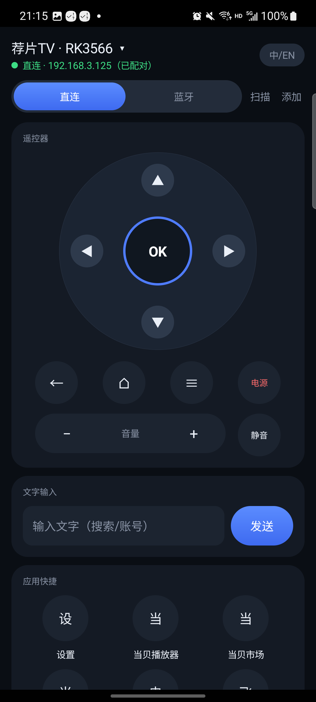
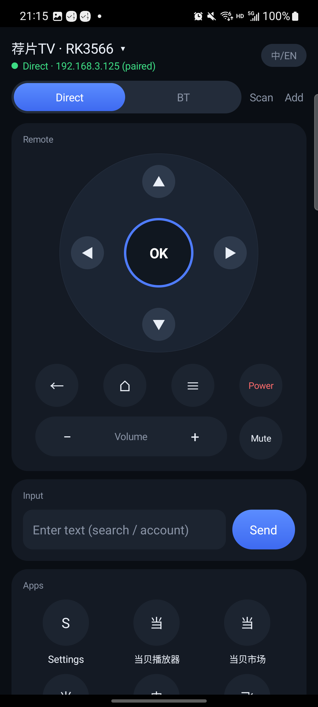
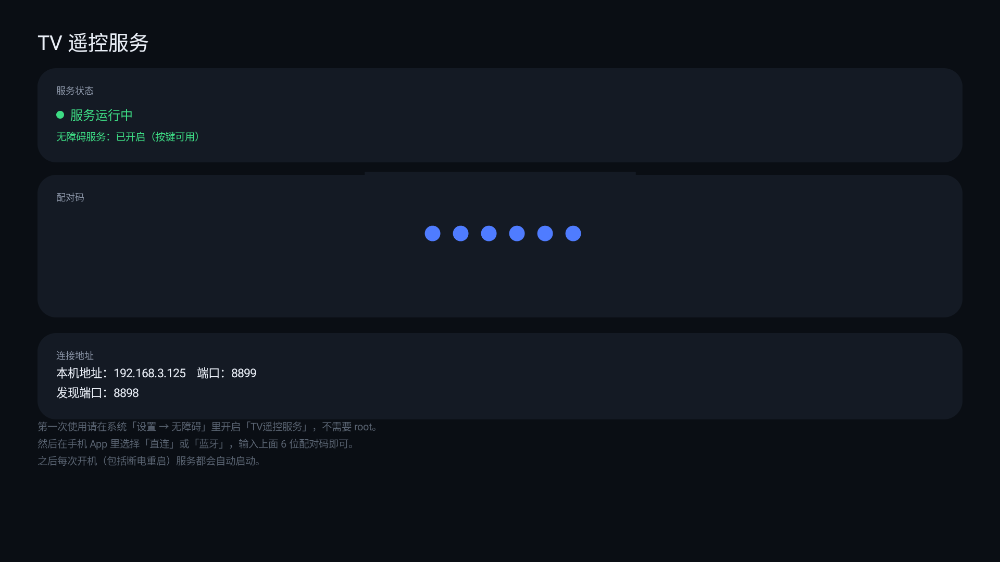
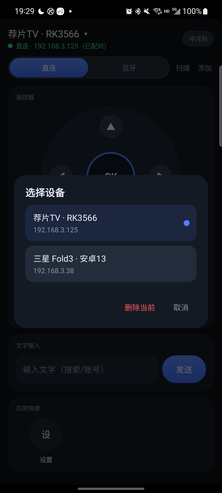
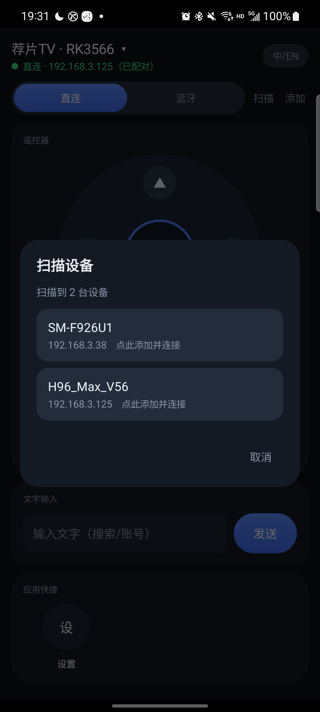
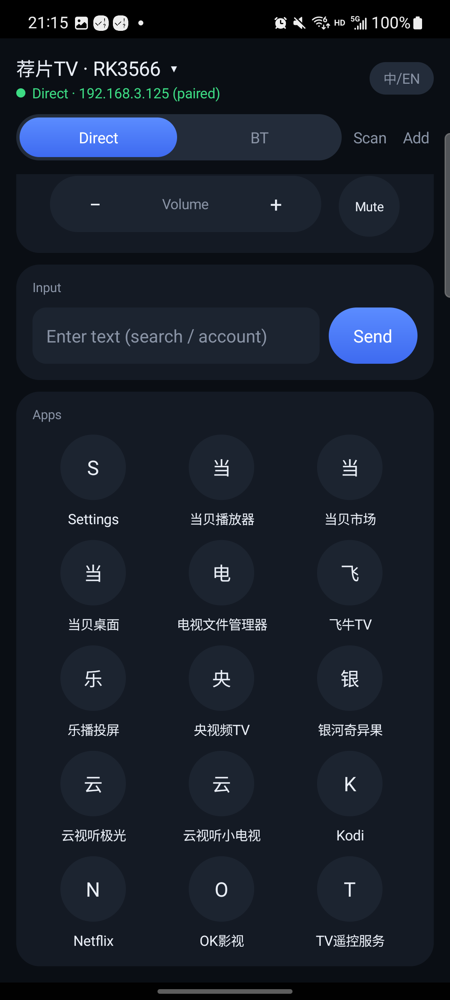

# TV 遥控器 · TV Remote

[English](README.en.md) | 中文

用手机遥控安卓电视盒子。**不需要 root、不需要开发者选项、不需要无线调试**：
在盒子上装一个常驻服务，手机与盒子连同一个局域网即可控制；盒子重启后服务自动恢复。
没有安装盒子端 App 时，也可以用手机蓝牙 HID 应急遥控。

- 控制端：Android 手机（开发与验证机型：三星 Note20，Android 13）
- 被控端：Android 电视盒子（验证机型：H96 Max V56 / Android 12、三星 Fold3 / Android 13）
- 两端 APK 均手工编译，无第三方依赖，体积约 100–120 KB

---

## 项目用途

把手机变成电视盒子的全能遥控器，解决三类日常问题：

1. **找不到遥控器**：手机常在手边，方向、OK、返回、主页、音量、静音、电源全部可点。
2. **电视上打字太难**：在手机上输入搜索词、账号密码，直接写进盒子当前输入框。
3. **常用应用层级太深**：一键启动盒子上安装的可启动第三方应用（OK影视、飞牛TV、Kodi 等）或系统设置。

同时管理多台盒子：扫描或手动添加设备，切换设备时自动使用该设备上次的连接方式和配对信息。

## 界面截图

<table>
  <tr>
    <td align="center"><br>手机端（中文）</td>
    <td align="center"><br>手机端（English）</td>
    <td align="center"><br>盒子端服务（配对码 / 地址 / 无障碍状态）</td>
  </tr>
  <tr>
    <td align="center"><br>设备选择与删除</td>
    <td align="center"><br>局域网自动扫描</td>
    <td align="center">盒子端界面跟随盒子系统语言；手机端可在「中/EN」切换</td>
  </tr>
  <tr>
    <td align="center"><br>应用快捷（中文界面）</td>
    <td align="center"><br>应用快捷（English 界面）</td>
    <td align="center">应用名称来自盒子系统语言，按名称排序；首项固定为「设置」</td>
  </tr>
</table>

## 两种连接方式

| | 局域网直连（推荐） | 蓝牙 HID（备用） |
|---|---|---|
| 原理 | 手机 TCP 连接盒子端常驻服务 | 手机注册为蓝牙键盘/遥控器 |
| 前提 | 盒子端安装「TV遥控服务」并开启无障碍 | 手机与盒子完成蓝牙配对 |
| 方向 / OK / 返回 / 主页 / 菜单 / 电源 | 支持 | 支持 |
| 音量 / 静音 | 支持 | 支持 |
| 文字输入 | 支持 | 不支持 |
| 应用快捷 | 支持 | 不支持 |
| 自动发现 | 支持（UDP 广播） | 需在系统蓝牙设置里配对 |
| 适用场景 | 日常首选，功能完整，重启自愈 | 盒子没装 App、或临时应急 |

> 直连的按键与文字由盒子端无障碍服务注入，应用启动和音量不依赖无障碍；
> 蓝牙模式要求手机 App 保持在前台（Android 会在应用退到后台时注销 HID 注册，回到前台会自动重新注册）。

## 架构

```
┌──────────────────────────┐                       ┌────────────────────────────────┐
│ 手机端 TV遥控器.apk        │      TCP 8899         │ 盒子端 TV遥控服务.apk            │
│                          │ ────────────────────► │                                │
│  · 方向 / OK             │   PAIR / KEY / TEXT   │  ServerService（前台常驻）       │
│  · 返回 / 主页 / 菜单     │   APP / LIST / PING   │   ├ 监听 TCP 8899               │
│  · 音量 / 静音 / 电源     │ ◄──────────────────── │   ├ 每 3 秒 UDP 8898 广播        │
│  · 文字输入 / 应用快捷     │                       │   ├ BootReceiver 开机自启        │
│  · 设备扫描与切换         │      UDP 8898         │   └ 无障碍服务（无 root 注入）    │
│                          │ ◄──── 设备广播 ─────── │                                │
└──────────────────────────┘                       └────────────────────────────────┘
          │
          └── 蓝牙 HID ──────────► 盒子蓝牙栈（此模式不需要盒子端 App）
```

## 使用条件

### 安卓版本要求

| 组件 | 最低版本 | 已验证版本 |
|---|---|---|
| 手机端 · 直连模式 | Android 8.0（API 26） | Android 13（三星 Note20） |
| 手机端 · 蓝牙 HID 模式 | Android 9.0（API 28） | Android 13（三星 Note20） |
| 盒子端 App | Android 8.0（API 26） | Android 12（H96 Max V56）、Android 13（三星 Fold3） |

- 蓝牙 HID 依赖系统 `BluetoothHidDevice`（API 28+）；低于 Android 9 的手机只能用直连。
- 模拟器/无蓝牙设备会自动提示「这台手机不能做蓝牙遥控器」，直连不受影响。

### 盒子端条件

1. 必须是可安装第三方 APK 的安卓电视盒子或安卓电视；非安卓系统（webOS、Tizen、传统电视）不支持。
2. 需安装「TV遥控服务」并**手动开启无障碍服务**：盒子「设置 → 无障碍 → TV遥控服务」。
   未开启时按键/文字返回 `ERR a11y`；音量、应用启动、应用列表仍可用。
3. **不需要 root**。盒端通过 `AccessibilityService`、`AudioManager`、`PackageManager` 完成控制。
4. 建议盒子保持联网（有线或 WiFi）。服务以前台通知常驻，并在开机/重启后自动拉起；
   个别固件有后台限制时，需在系统设置中允许本应用自启。
5. 盒子端界面在部分固件上不响应触摸（实测 H96），可用盒子自带遥控器聚焦后按 OK，
   或通过 ADB 打开系统设置。

### 网络条件

- 手机与盒子必须在**同一局域网/同一网段**。
- 直连使用 **TCP 8899**（控制）和 **UDP 8898**（设备发现广播）。
- 路由器若开启 **AP 隔离**，自动发现会失败，但可以用「添加」手动填写盒子 IP。
- 建议在路由器上为盒子保留固定 IP（DHCP 静态分配）；IP 变化后需要重新添加设备。

### 明确不适用的场景

- 控制电视本身的电源与音量（红外 / HDMI-CEC）——本项目的电源键是盒子系统锁屏，
  音量键调的是盒子媒体音量。
- 跨网段、外网远程控制。协议是明文局域网协议，不要把 8899 暴露到公网。
- iOS 手机（本项目仅提供 Android 客户端）。

## 快速开始

### 1. 盒子端

1. 从 Releases 下载 `TVRemoteServer.apk` 安装（U 盘安装或 `adb install`）。
2. 打开「TV遥控服务」，允许通知权限。界面会显示 **6 位配对码** 和 **本机 IP**。
3. 进入盒子「设置 → 无障碍」，开启「TV遥控服务」。
4. 之后保持服务运行即可；开机/重启会自动启动。

> 配对码在首次启动时随机生成并保存在应用私有存储中，清除应用数据或重装会生成新码。

### 2. 手机端 · 局域网直连

1. 从 Releases 下载 `TVRemote.apk` 安装，手机与盒子连同一个 WiFi。
2. 打开 App。点顶部「扫描」，在扫描结果里点选盒子；或点「添加」手动填写名称和 IP。
3. 点「直连」，输入盒子屏幕上的 6 位配对码，点「配对并连接」。
4. 配对成功后即可按键。配对信息按盒子 IP 保存，下次打开自动恢复。

> 首次启动的设备列表自带两条示例设备（荐片TV · RK3566、三星 Fold3）。
> 点顶部设备名 →「删除当前」即可替换成你自己的盒子；列表至少保留一台。

### 3. 手机端 · 蓝牙 HID（可选）

1. 手机打开蓝牙；盒子打开蓝牙并进入「搜索设备」。
2. 手机点「蓝牙」。若还没有已配对设备，点「让盒子搜索这台手机」（开启 120 秒可见）。
3. 在盒子蓝牙列表中选择这台手机，两边确认配对码。
4. 回到 App 再点「蓝牙」，选择刚配对的盒子，状态显示「蓝牙已连接」后即可按键。

## 日常使用

| 操作 | 说明 |
|---|---|
| 点击设备名 | 切换设备、删除当前设备 |
| 扫描 | 监听盒子 UDP 广播，列出局域网内所有盒子，点一下即添加并连接 |
| 添加 | 手动输入设备名称和盒子 IP |
| 直连 | 未配对时弹出配对框；已配对则直接进入直连 |
| 长按直连 | 清除当前设备的配对信息，用于盒子重置或换盒子 |
| 蓝牙 | 注册 HID 并连接已配对的盒子；切换设备时会自动连该设备记住的蓝牙目标 |
| 中/EN | 中文 / English / 跟随系统，即时生效并持久保存 |
| 方向键与 OK | 直连时优先用系统 DPAD 全局动作；固件不支持时自动改为焦点遍历 |
| OK 短按 / 长按 | 蓝牙模式按住 OK 时盒子持续收到「按下」，由 TV 应用自行判定长按；直连模式按住 500ms 以上在抬起时发送长按命令 |
| 飞鼠（右上角 ↖） | 仅蓝牙模式：开启后转动手机移动盒子光标，OK 键为鼠标左键；再次点击关闭 |
| 返回 / 主页 | 系统全局返回、桌面 |
| 菜单 | 打开最近任务（非 root 环境没有菜单键全局动作） |
| 电源 | 盒子系统锁屏（不是真正关机） |
| 音量 / 静音 | 调整盒子媒体音量 |
| 文字输入 | 写入盒子当前焦点输入框；当前界面没有输入框时提示执行失败 |
| 应用快捷 | 动态显示盒子全部可启动的第三方应用（名称 + 首字图标） |
| 检查更新 | 手机端在「关于」卡、盒子端在「版本更新」卡读取 GitHub 最新 Release，下载后由系统安装界面确认 |

### 应用快捷的显示规则

手机端通过 `LIST` 命令获取盒子上的第三方应用，载荷为
`包名|base64(应用名)`；界面按应用名排序动态生成，
首项固定为「设置」（`com.android.settings`，系统应用，始终显示）。

- 应用名取盒子系统语言下的 `PackageManager.getApplicationLabel`；
- 只包含有启动入口（LAUNCHER / LEANBACK_LAUNCHER）的第三方应用；
- 应用图标不做传输，显示名称首字；
- 应用快捷和文字输入只在直连模式可用。

## 常见问题

| 现象 | 原因与处理 |
|---|---|
| 提示「连接被拒绝：盒子端服务未运行」 | 在盒子上打开「TV遥控服务」 |
| 提示「连接超时 / 连接失败」 | 盒子离线、IP 变化，或手机与盒子不在同一 WiFi |
| 提示「配对码错误」 | 对照盒子屏幕重新输入 6 位数字；清除应用数据后配对码会变 |
| 提示「配对已失效」 | 长按「直连」清除配对，再重新配对一次 |
| 按键提示「盒子端未开启无障碍服务」 | 盒子「设置 → 无障碍」开启「TV遥控服务」 |
| 按键提示「盒子执行失败」 | 当前界面没有可操作焦点/输入框，先在盒子上打开目标界面 |
| 扫描不到盒子 | 检查同一 WiFi、盒子服务是否运行、路由器是否开启 AP 隔离；可手动添加 IP |
| 方向键没反应 | 该界面没有可聚焦元素（如全屏播放器）；部分固件只能走焦点遍历 |
| 蓝牙按键没反应 | App 需在前台；回前台后重新点「蓝牙」；确认已显示「蓝牙已连接」 |
| 飞鼠开启后光标不动 | 盒子端缓存了首次配对时的 HID 描述符：在盒子蓝牙设置里删除与手机的配对，再重新配对一次；H96 等固件删除配对后仍不生效时，需重启盒子蓝牙或在 root 下改 `bt_config.conf` 的 `HidDescriptor` |
| 盒子重启后连不上 | 确认服务已自启；部分固件需允许应用自启，或重新打开一次 App |

## 构建

需要：

- Python 3
- JDK 11+（`javac` 需在 PATH；已验证 JDK 21）
- Android SDK：`build-tools/36.1.0`、`platforms/android-35`

```powershell
python build.py app       # -> dist/TVRemote.apk
python build.py server    # -> dist/TVRemoteServer.apk
```

`build.py` 默认从 `%LOCALAPPDATA%\Android\Sdk` 查找 SDK；构建链为
aapt2 → javac → d8 → 打包 dex → zipalign → apksigner。

### 签名密钥

`keys/` 不入库（`.gitignore`），`keys/release.jks` 丢失后无法覆盖升级已安装的 App，
只能卸载重装。请自行备份该文件。

## 直连协议

盒子端 TCP 8899，每行一条命令，`\n` 结尾。

| 发送 | 返回 | 说明 |
|---|---|---|
| `PING` | `PONG` | 探活，无需认证 |
| `PAIR <6位配对码>` | `OK <token>` / `ERR badcode` | 用配对码换长期 token |
| `KEY <token> <keycode>` | `OK` / `ERR auth` / `ERR a11y` / `ERR cmd` / `ERR exec` | 注入按键 |
| `KEYLONG <token> <keycode>` | `OK` / `ERR auth` / `ERR a11y` / `ERR cmd` / `ERR exec` | 长按注入（仅 23/OK），对焦点节点执行 `ACTION_LONG_CLICK` |
| `TEXT <token> <base64>` | `OK` / `ERR a11y` / `ERR exec` | 写入当前输入框（base64 编码 UTF-8） |
| `APP <token> <包名>` | `OK` / `ERR exec` | 启动应用，不依赖无障碍 |
| `LIST <token>` | `OK <包名\|base64(应用名),逗号分隔>` | 第三方可启动应用列表，不依赖无障碍 |

UDP 8898 广播格式：`TVREMOTE|8899|<盒子型号>`，每 3 秒一次，供手机自动发现。

## 目录结构

```
tv-remote/
├── app/                    # 手机端 com.koco.tvremote
│   ├── AndroidManifest.xml
│   ├── res/                # 图标 + 中英文文案（默认中文，values-en 英文）
│   └── src/com/koco/tvremote/
│       ├── MainActivity.java   # 界面与交互（纯代码构建，无 layout XML）
│       ├── LanClient.java      # 直连客户端（TCP + UDP 发现）
│       ├── BtHid.java          # 蓝牙 HID 键盘/消费者控制/鼠标（飞鼠）
│       └── Errors.java         # 异常到本地化报错文案
├── server/                 # 盒子端 com.koco.tvremoteserver
│   ├── AndroidManifest.xml
│   ├── res/                # 图标 + 界面/通知文案
│   └── src/com/koco/tvremoteserver/
│       ├── MainActivity.java                  # 配对码 / 地址 / 无障碍状态
│       ├── ServerService.java                 # 前台服务，TCP 8899 + UDP 8898
│       ├── TvRemoteAccessibilityService.java  # 无 root 按键/文字注入
│       └── BootReceiver.java                  # 开机自启
├── docs/screenshots/       # README 截图
├── tools/                  # PC 端 Java 协议原型（ADB / TLS）
├── build.py                # 一键构建
├── keys/                   # 签名与密钥（不入库）
└── dist/                   # 构建产物（不入库）
```

## 安全说明

- 直连协议是**明文 TCP**，仅设计用于可信局域网；不要在路由器上把 8899 端口映射到公网。
- 配对码只用于换取 token；之后的命令都要求 token。
- 盒子端服务只接受命令，不提供文件访问或任意命令执行能力。

## 已知限制

- 「电源」是系统锁屏，不能真正关机/开机；「菜单」是最近任务，不是传统菜单键。
- 音量只调节盒子媒体音量，不控制电视或功放。
- 文字输入要求当前界面存在可编辑输入框，且盒子输入法接受 `ACTION_SET_TEXT`。
- 部分电视固件不支持 DPAD 全局动作（实测 H96 Android 12），已回退到焦点遍历；
  界面没有可聚焦控件时方向键无效果。
- 蓝牙 HID 模式不支持文字输入与应用快捷，且 App 需保持前台。
- OK 长按在蓝牙模式由盒子应用自行判定；直连模式依赖焦点节点支持
  `ACTION_LONG_CLICK`，不支持长按的应用无效果。
- 飞鼠只在蓝牙 HID 模式可用：直连协议没有移动系统光标的能力；盒子需接受
  蓝牙鼠标 HID 报告。手机没有陀螺仪时无法开启飞鼠，横竖屏均可但灵敏度为固定值。
- 盒子端会把**首次配对时**的 HID 报告描述符持久化在配对记录里（H96 实测存于
  `/data/misc/bluedroid/bt_config.conf` 的 `HidDescriptor`，Fold3 在重连时重新读取）。
  从旧版本升级后，曾用旧版配对过的盒子（尤其是 H96 这类定制固件）需删除配对并
  重新配对一次，否则盒子仍按「无鼠标」的旧描述符建输入设备，飞鼠无反应。
- 应用快捷覆盖盒子上有启动入口的第三方应用；纯服务类/无桌面入口的应用不会列出。
- 盒子端 `LIST` 依赖 Android 11+ 的包可见性声明（manifest 中的 `<queries>`）。
- 应用内更新需要能访问 `api.github.com`；接口匿名限流为每小时 60 次，超限时提示稍后重试。
- 安装包通过 GitHub API 的资产端点下载（浏览器下载域名在部分网络会被卡住）；
  仍有网络无法访问 GitHub 时需自备代理。
- 更新必须经过系统安装确认，无法静默安装；部分安卓版本还需在系统设置里允许本应用
  安装未知应用。盒子端安装界面需要用物理遥控选择确认。
- 盒子端「检查更新」按钮同时处理遥控 OK/ENTER 与触屏点击（部分固件可聚焦 TextView
  不响应默认 OK 事件）。

## 版本

- v1.5.0：OK 键支持短按/长按（蓝牙发按下-抬起，直连新增 `KEYLONG` 长按命令）；
  遥控器卡右上角新增飞鼠键，蓝牙 HID 模式用手机陀螺仪移动盒子光标，OK 为左键。
  升级说明：曾在旧版本配对过的盒子需删除配对并重新配对一次，飞鼠才会生效。
- v1.4.1：修复更新安装回调不弹出系统确认界面的缺陷（PendingIntent 需为 MUTABLE）；
  安装包改走 GitHub API 资产端点下载，超时放宽到 30 秒；盒子端更新按钮补 OK/ENTER 处理。
  v1.4.0 的 OTA 有上述缺陷，需手动安装一次 v1.4.1 才能正常使用应用内更新。
- v1.4.0：两端新增应用内检查更新，读取 GitHub 最新 Release 并下载对应 APK，
  由系统安装界面完成升级；盒子端更新后服务自动恢复。
- v1.3.0：应用快捷动态化，`LIST` 同时返回应用名（`包名|base64(应用名)`），
  手机端动态展示盒子全部可启动的第三方应用；盒子端补 `<queries>` 适配
  Android 11+ 包可见性。
- v1.2：盒端去 root，改用无障碍服务注入；连接方式与蓝牙目标按设备记忆；
  蓝牙返回/主页改用消费者控制（`AC Back` / `AC Home`）。
- v1.1：移除手机端 ADB 控制，保留「直连 + 蓝牙」两种方式。

## 许可

本项目采用 [PolyForm Noncommercial License 1.0.0](LICENSE)：
允许个人学习、研究、测试以及非商业组织使用，**禁止任何商业用途**。
分发或修改后的作品必须保留本许可与版权声明。

问题反馈与使用疑问请提交 GitHub Issues。
